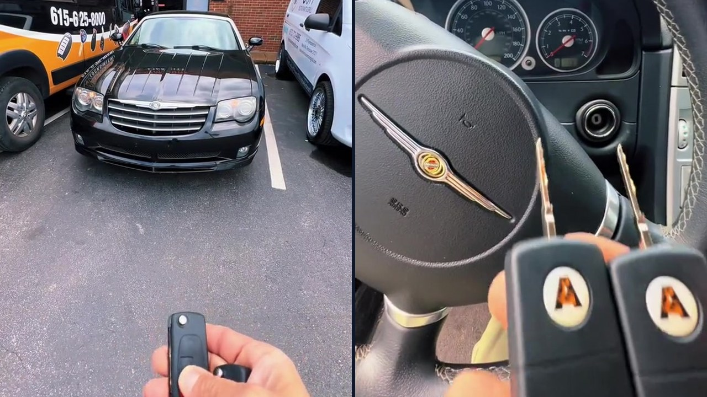
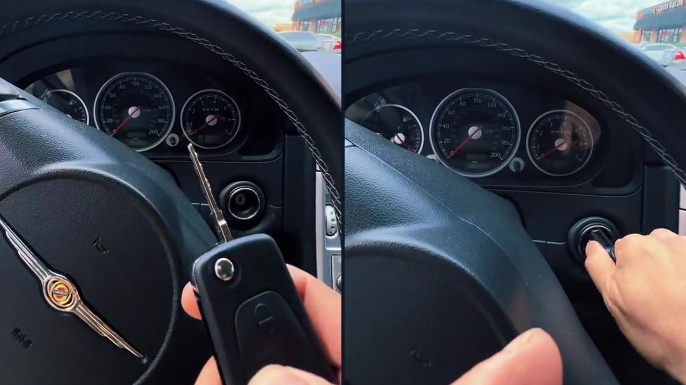

## Why the 2004–2008 Chrysler Crossfire Is One of the Hardest Cars to Make a Key For

If you lose the last key to a **2004–2008 Chrysler Crossfire** — whether it is a Base coupe, a Limited roadster, or a supercharged **SRT-6** like the black 2007 model in the video above — you find out fast why almost nobody wants to touch this car.

Call a Chrysler dealership and they will tell you Crossfire keys have been discontinued for years. Call a Mercedes-Benz dealership and they will turn you down because your car carries a Chrysler VIN (`1C3`), even though the car underneath is German. Call ten mobile locksmiths around town and nine or ten of them will tell you they cannot program it.

The reason comes down to how the car was built:

- **German Mercedes-Benz R170 Platform:** Chrysler had Karmann build the Crossfire in Osnabrück, Germany on the **Mercedes-Benz R170 SLK320** chassis (and the **SLK32 AMG** supercharged V6 drivetrain on the SRT-6).
- **SKREEM / Mercedes DAS Immobilizer:** Instead of a regular Chrysler Sentry Key system that programs through the OBD2 port in two minutes, the Crossfire uses a Mercedes-built **SKREEM (Sentry Key Remote Entry Module)** paired with a rolling-code transponder chip. Standard plug-in OBD key programmers cannot add a key to this car.
- **HU64 High-Security Laser Blade:** The mechanical flip blade is a two-track [Mercedes-Benz](/mercedes-benz/) `HU64` high-security laser key, not a standard domestic Chrysler key blank.

## Important: Crossfires Have to Be Towed to Our 208 Thompson Ln Shop

Unlike most domestic and [European car key jobs](/european-car-key-specialist/) that our mobile locksmith vans handle in your driveway, **to make a key for a 2004–2008 Chrysler Crossfire when all keys are lost, you have to tow the car to [our locksmith shop at 208 Thompson Ln, Nashville, TN 37211](/nashville-locksmith-storefront/)**.

Making a working Crossfire key from scratch requires pulling and bench-reading the encrypted immobilizer data directly at our shop bench, generating rolling-code transponder chips matched to your exact vehicle, cutting the `HU64` high-security laser flip blades, and testing ignition start and remote lock/unlock synchronization right on the car before it leaves our parking lot.

> **Still have one working Crossfire key?** Do not wait until that last 20-year-old flip key breaks or gets lost. Drive your Crossfire to our **208 Thompson Ln** shop while it still starts so we can cut and program a spare flip key without you ever paying a tow truck bill.

## Two New Flip Remote Keys Made for This 2007 Chrysler Crossfire SRT-6

When this black **2007 Chrysler Crossfire SRT-6** arrived at our Thompson Lane shop, the owner wanted to make sure he would never be stuck with a zero-key Crossfire again. Here is what we completed in-house:

1. **Bench Immobilizer Programming:** Read the Crossfire's immobilizer data on our shop bench and wrote **two** new rolling-code transponder chips matched directly to the car.
2. **High-Security Laser Cutting (`HU64`):** Cut two fresh `HU64` high-security laser flip blades so both keys turn the door cylinder and ignition smoothly without binding.
3. **Keyless Entry Remote Sync:** Synced both 3-button flip [key fobs](/key-fob-replacement-nashville/) so lock, unlock, and panic work reliably from outside the car.
4. **Full Shop Road-Readiness Check:** Tested both remotes outside our front door (`208`) and started the supercharged SRT-6 engine with **Key #1** and **Key #2** back-to-back.

## Need a 2004–2008 Chrysler Crossfire Key in Nashville or Middle Tennessee?

Because dealerships no longer supply these keys, we get calls on Crossfires from across **Nashville, Brentwood, Franklin, Antioch, Hermitage, Donelson, Belle Meade, and Green Hills** — as well as Crossfire owners towing their cars into Nashville from across Tennessee.

Before you book a tow truck, give us a quick call at **(615) 625-8000** or send a message through [our online booking page](/book-online/) so I can confirm our current Crossfire flip-key stock and give you an upfront shop quote and drop-off time at **208 Thompson Ln, Nashville, TN 37211**.
