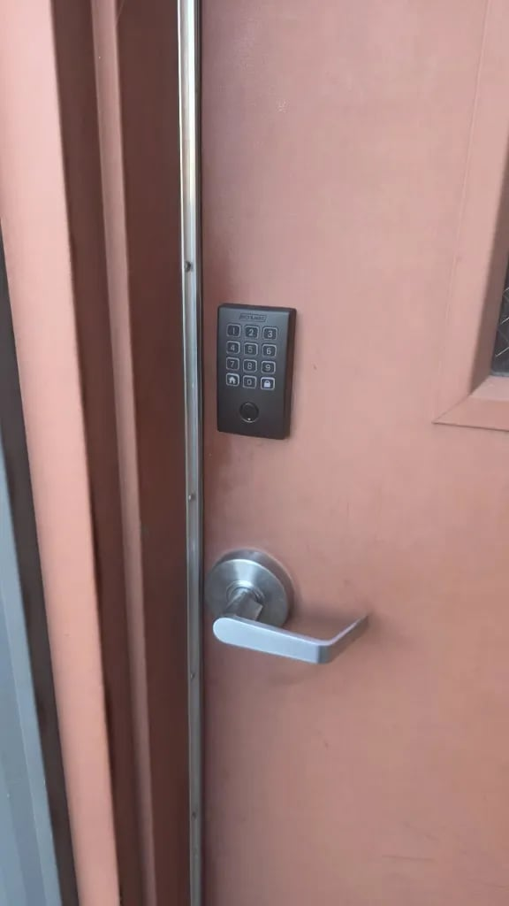
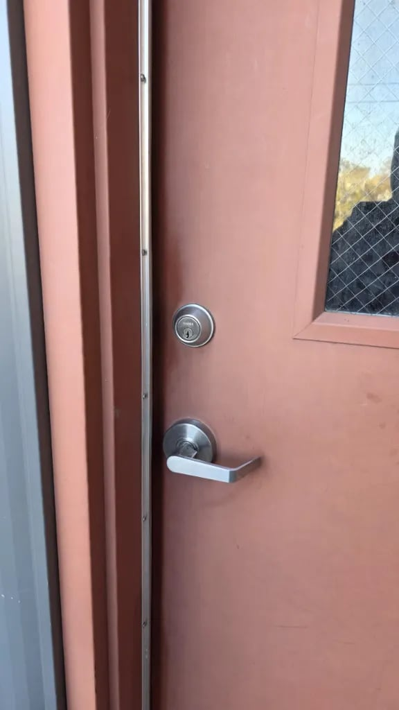

## Converting a Commercial Steel Door Deadbolt to Keyless PIN Access

Many offices, warehouses, back entrances, and commercial suites across **The Gulch, East Nashville, The Nations, Midtown, and South Nashville** still use a standard keyed deadbolt above a commercial lever handle. Every time an employee leaves, a vendor stops servicing the building, or someone misplaces a key, management has to either track down metal copies or schedule a full lock rekey.

Today, **Armstrong Locksmith Inc** field technician **Kawa** upgraded a heavy-duty commercial hollow-metal steel door in the Nashville area by converting its existing keyed **Hager** commercial deadbolt into a **Schlage** electronic keypad deadbolt — keeping the existing commercial lever handle and full-length door latch guard intact.

---

## Before & After: What Kawa Did on This Commercial Door

### 1. Removed the Keyed Hager Commercial Deadbolt
The door originally had a satin-chrome **Hager** single-cylinder deadbolt mounted above a heavy-duty Grade 1 commercial lever handle, protected by a full-length metal astragal latch guard along the frame edge.

### 2. Fitted & Aligned the Schlage Electronic Keypad Deadbolt
Installing an electronic deadbolt on a commercial hollow-metal steel door takes careful latch and strike plate alignment — especially when a steel latch guard runs right along the door edge:

- **Clean Conversion Using Existing Door Prep:** Kawa removed the old Hager deadbolt cylinder and latch, checked the steel bore and backset, and mounted the **Schlage** electronic keypad deadbolt flush against the door face without damaging the frame or latch guard.
- **Smooth Motorized Bolt Alignment:** If a commercial steel door bolt rubs even slightly against the strike plate, an electronic deadbolt will jam and burn through batteries. Kawa tuned the latch throw and frame strike so the bolt locks and unlocks cleanly every cycle.
- **Individual Staff PIN Codes + Physical Key Backup:** The business can now hand out unique PIN codes to employees, cleaners, or managers — and delete a single code in seconds when someone leaves, while keeping a physical backup keyway for manager override or [commercial master key access](/commercial-locksmith/).

---

## Common Questions About Commercial Deadbolt-to-Keypad Upgrades

### Can you convert a keyed deadbolt on a commercial steel door to a keypad lock?
Yes. Most commercial steel and wood doors with a standard 2-1/8 inch deadbolt bore can be converted directly to a **Schlage** electronic keypad deadbolt or a heavy-duty commercial keypad lever (such as **Alarm Lock Trilogy DL2700**, **Dormakaba E-Plex 2000**, or **Yale** commercial keypads) without replacing the entire door.

### Do we still need to rekey locks if an employee leaves?
With a keypad deadbolt, you simply delete that employee's PIN code right on the lock — no metal keys to chase down and no emergency after-hours rekey. If you also have other keyed doors on the building, our mobile vans can handle [commercial lock rekeying](/nashville-rekey-service/) or key the keypad's backup cylinder to match your existing Schlage keyway.

### What if our commercial door is aluminum glass instead of solid steel?
For narrow-stile aluminum glass storefront doors, standard round deadbolts won't fit the thin frame. For those doors, we install **Adams Rite** mortise deadlatches, interior push exit paddles, and narrow-stile **Alarm Lock Trilogy DL1200** keypads — see our [Nashville storefront keypad conversion job](/blog/commercial-mortise-lock-converted-to-alarm-lock-keypad-nashville/) and [South Nashville Adams Rite mortise deadlatch job](/blog/commercial-mortise-deadlatch-installation-lock-rekey-nashville-37211/).

---

## Need a Commercial Keypad Lock or Door Hardware Upgrade in Nashville?

Founded in Nashville in **2015** and backed by **over 20 years of hands-on locksmith experience**, our local in-house team (**Rahim, Kawa, and Sako**) provides full [commercial locksmith services](/commercial-locksmith/) for offices, retail shops, restaurants, studios, and warehouses across **The Gulch (`37203`), East Nashville (`37206`), The Nations (`37209`), Midtown, Germantown, Berry Hill, Downtown Nashville**, and surrounding communities including [Brentwood, Franklin, Donelson, Hermitage, Green Hills, Belle Meade, and Antioch](/service-areas/) — including storefront locks, keypad conversions, master key systems, **Detex** exit alarms, and itemized corporate invoices.

- **Walk-In Shop (`$0` Service Call Fee):** Bring loose commercial cylinders or keys into [our storefront at 208 Thompson Ln, Nashville, TN 37211](/nashville-locksmith-storefront/) (`$20/cylinder` in-shop rekeying; `Mon–Fri 8:00 AM – 6:00 PM`, `Sat 10:00 AM – 4:00 PM`, `Closed Sun`).
- **Mobile Commercial Vans:** Call or text **(615) 625-8000** for same-day on-site commercial lock upgrades and repairs (`Mon–Fri 8:00 AM – 11:30 PM`, `Sat 10:00 AM – 4:00 PM`, `Closed Sun`).
- **Upfront Pricing:** View our [2026 Nashville Locksmith Price Guide](/locksmith-pricing-nashville/) or [book service online](/book-online/).
