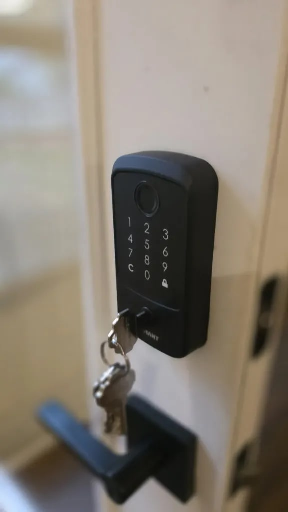
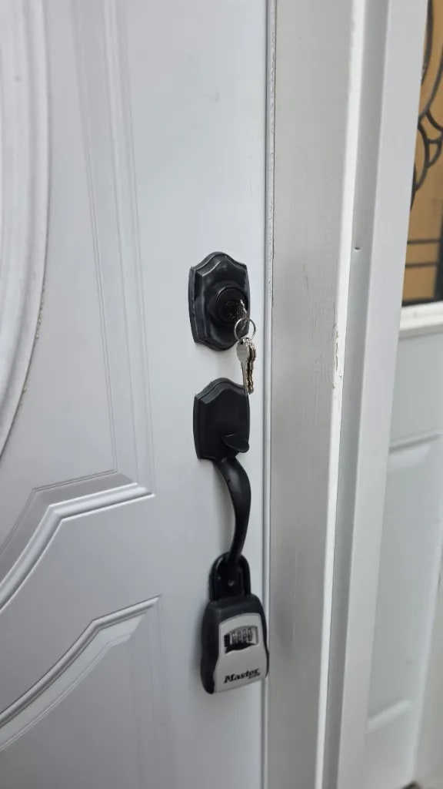

## Residential Lock Rekeying & Keypad Deadbolt Setup in Franklin, TN

When homeowners in **Franklin, TN** want tighter control over who has access to their home, rekeying existing locks and adding an electronic keypad deadbolt is one of the fastest, cleanest upgrades you can make. Today, **Armstrong Locksmith Inc** field technician **Kawa** completed a residential lock rekey and matte black **Defiant** electronic keypad and fingerprint deadbolt job in **Franklin, TN** — all in a single on-site visit from our mobile locksmith van.

---

## What Kawa Did on This Franklin, TN Home Job

1. **Front-Door Deadbolt & Handleset Rekeying:** Notice the realtor lockbox still hanging from the front handleset — whenever keys have changed hands through a move-in, contractors, or showings, old keys stay active until the cylinders are re-pinned. Kawa rekeyed the exterior cylinders so old copies no longer open the home, and cut fresh keys that work cleanly across the doors.

2. **Inspected & Aligned the Defiant Electronic Keypad Deadbolt:** Even the best keypad deadbolt will stick or drain batteries fast if the bolt rubs inside the frame. Kawa checked door alignment and bolt throw depth on the matte black **Defiant** electronic keypad and fingerprint deadbolt so the motorized bolt throws cleanly without binding, while matching its physical backup keyway to the homeowner's fresh house keys.

> **Why Rekeying Saves Money vs. Buying All-New Door Hardware:** If your existing exterior levers, handlesets, and deadbolts are still solid mechanically, [professional lock rekeying](/nashville-rekey-service/) gives you brand-new key control at a fraction of the price of replacing full architectural hardware sets — and you can key multiple exterior doors to match a single house key.

---

## Need Residential Lock Rekeying or a Keypad Lock Installed in Franklin or Nashville?

Founded in Nashville in **2015** and backed by **over 20 years of hands-on locksmith experience**, our in-house technicians (**Rahim, Kawa, and Sako**) handle [residential locksmith work](/residential-locksmith-nashville/) across **Schlage, Kwikset, Baldwin, Yale, Weiser, Defiant, and commercial-grade locks** throughout [Franklin, Brentwood, Nashville, Nolensville, Green Hills, and Belle Meade](/service-areas/).

- **Walk-In Shop Rekeying (`$0` Service Call Fee):** Removing a loose lock cylinder or keypad and bringing it to [our Nashville storefront at 208 Thompson Ln, Nashville, TN 37211](/nashville-locksmith-storefront/) saves the mobile trip fee — in-shop cylinder rekeying is **`$20` per cylinder** (`Mon–Fri 8:00 AM – 6:00 PM`, `Sat 10:00 AM – 4:00 PM`, `Closed Sun`).
- **On-Site Mobile Van Service:** Want Kawa or our mobile locksmith team to rekey your whole home and install or key a smart keypad deadbolt right on your doors? Call or text **(615) 625-8000** (`Mon–Fri 8:00 AM – 11:30 PM`, `Sat 10:00 AM – 4:00 PM`, `Closed Sun`).
- **Upfront Rates:** Check our full [2026 Nashville Locksmith Price Guide](/locksmith-pricing-nashville/) anytime before booking.
