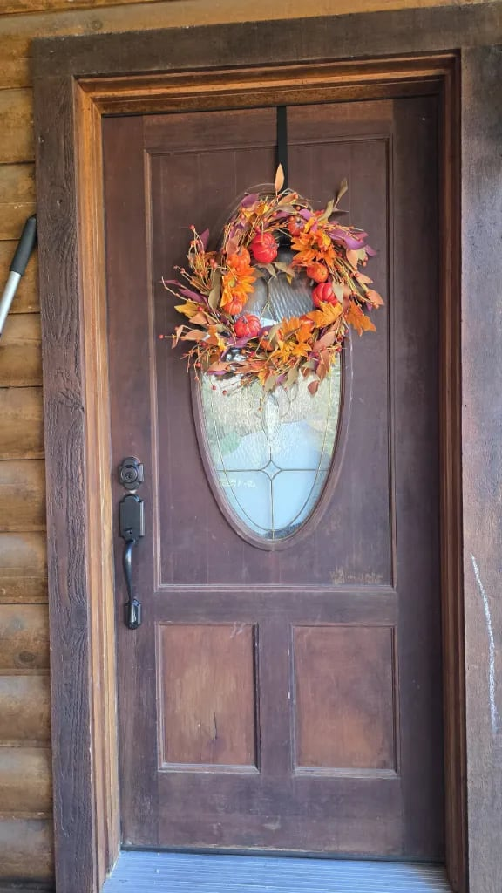
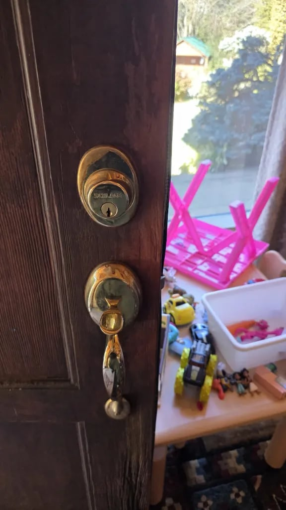
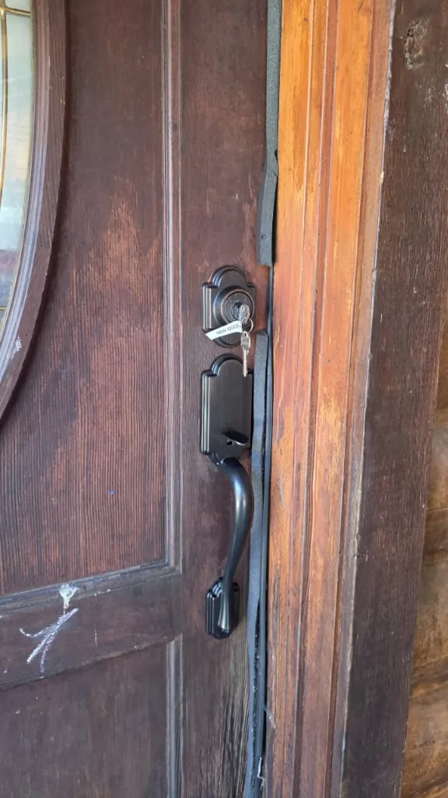

## Upgrading a Worn Brass Front Door Lock Set to a New Matte Black Handleset

Homeowners across **East Nashville, The Nations, The Gulch, 12 South, Sylvan Park, and Green Hills** often call us asking whether they should **rekey** their current front door locks or **replace the entire handleset and deadbolt**. When existing locks are still mechanically tight and you like the finish, [lock rekeying](/nashville-rekey-service/) saves the most money. When the old brass hardware is worn out, sticky, or ready for a modern finish upgrade, replacing the full handleset and deadbolt gives you both fresh security and a clean new look on your entry door.

Recently, our [residential locksmith team](/residential-locksmith-nashville/) replaced a weathered polished-brass **Schlage** front door deadbolt and thumb-latch handleset with a brand-new matte black architectural handleset and deadbolt — complete with fresh keys and smooth latch alignment.

---

## Before & After: Front Door Lock Set Replacement

### 1. Before: Weathered Brass Schlage Deadbolt & Handleset
Over years of Tennessee humidity, sun exposure, and daily family traffic, older exterior brass handlesets wear down inside the thumb latch and cylinder pins, making the key catch or requiring extra force to pull the door shut.

### 2. After: New Matte Black Deadbolt & Sculpted Handleset
We removed the worn brass lock set, checked the wood door bore holes, lower through-bolt hole, and door frame strike plates, and fitted the new matte black deadbolt and matching thumb-latch handleset with newly cut house keys:

- **Clean Fit Over Existing Door Cutouts:** Front entry handlesets require exact spacing between the upper deadbolt, latch bore, and bottom grip through-bolt so nothing looks crooked or leaves old screw marks exposed.
- **Strike Plate & Weatherstripping Check:** Notice the exterior weatherstripping along the jamb — we verify the deadbolt throws all the way into the strike pocket without needing to shove the door closed.
- **Keyed Alike Across Your Home:** When we replace a front entry lock set, we can also [rekey your back door, side door, and garage entry locks](/nashville-rekey-service/) on the same visit so one single house key opens every exterior door.

---

## Common Questions from Nashville Homeowners

### Should I rekey my house locks or replace the whole lock set?
- **Choose Lock Rekeying** if your deadbolts and handles still work smoothly and you like how they look (for example, right after buying a house, tenant turnover, or lost keys). Changing the internal brass pins stops all old keys from working at a fraction of new hardware cost.
- **Choose Full Lock Replacement** if your handleset is worn, tarnished, loose, hard to turn, or if you want to upgrade to a modern matte black finish, ANSI Grade 1 deadbolt, or touchscreen smart keypad.

### How much does it cost to rekey locks vs. replace house locks in Nashville?
- **Walk-In Shop Rekeying (`$0` Service Call Fee):** Remove loose cylinders and bring them into [our shop at 208 Thompson Ln, Nashville, TN 37211](/nashville-locksmith-storefront/) for **`$20` per cylinder** while you wait.
- **Mobile Home Rekeying or Lock Replacement:** Our mobile locksmith vans come straight to your home or condo anywhere in **East Nashville (`37206`), The Nations (`37209`), The Gulch (`37203`), Germantown, 12 South, Sylvan Park**, and [Brentwood, Franklin, Belle Meade, Green Hills, Donelson, Hermitage, or Antioch](/service-areas/) with upfront flat pricing quoted over the phone before we start. See our full [2026 Nashville Locksmith Price Guide](/locksmith-pricing-nashville/).

### Do you give receipts for home warranty rekey reimbursement?
Yes. If you just moved into a home with a lock rekey benefit through **American Home Shield**, **First American**, or **Choice Home Warranty**, we give you a detailed, itemized paid invoice listing every lock cylinder serviced so you can submit it directly to your warranty provider.

---

## Need a Residential Locksmith in Nashville, Brentwood, or Franklin?

Founded in Nashville in **2015** and backed by **over 20 years of hands-on locksmith experience**, our local in-house technicians (**Rahim, Kawa, and Sako**) handle front door handleset upgrades, deadbolt installations, smart keypad locks, emergency house lockouts, and same-day lock rekeying.

- **Walk-In Storefront:** [208 Thompson Ln, Nashville, TN 37211](/nashville-locksmith-storefront/) (`Mon–Fri 8:00 AM – 6:00 PM`, `Sat 10:00 AM – 4:00 PM`, `Closed Sun`)
- **Mobile Residential Vans:** Call or text **(615) 625-8000** (`Mon–Fri 8:00 AM – 11:30 PM`, `Sat 10:00 AM – 4:00 PM`, `Closed Sun`) or [book service online](/book-online/).
