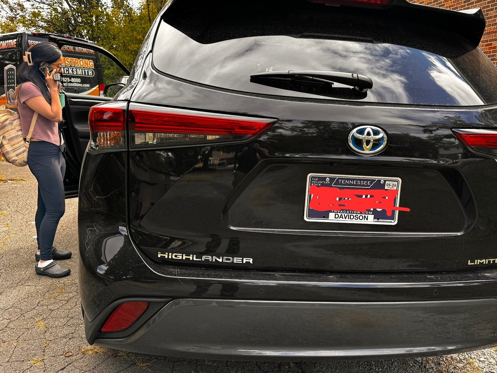

## All Keys Lost on a Toyota Highlander Hybrid Limited in Nashville

A customer in Nashville lost the keys to her silver **Toyota Highlander Hybrid Limited** while her SUV was locked. If you call the dealership when all keys are lost on a push-to-start Toyota hybrid, they tell you to pay a tow truck to bring the vehicle to their service bay and wait on parts and programming.

Instead of towing her SUV, she called our shop at **(615) 625-8000** and we brought our [mobile locksmith van](/automotive-locksmith-in-nashville-tn/) right out to where her Highlander was parked.

## How We Unlocked the SUV, Cut the Laser Key, and Programmed the Smart Fob

First we unlocked the vehicle with our damage-free lockout tools, and then we made a key for the door — which in this model is a laser key. Once we turned off the alarm with the mechanical key we just made, we reset the immobilizer for this vehicle and added a smart key and programmed it. Plus she asked us to delete lost keys, which we did at no extra charge just to give her more peace of mind that her car won't be stolen by whoever might have the key.

Here is why each of those steps matters on a push-to-start [Toyota Highlander](/toyota-car-key-replacement/):

- **Damage-Free Door Unlock:** We opened the locked driver's door cleanly with our professional [car unlock tools](/nashville-car-unlock-service/) — zero prying on the door frame or scratching the paint.
- **High-Security Laser Door Blade Cut First (To Silence the Factory Alarm):** On this Toyota Highlander model, the emergency door key is a high-security laser key (`TOY48`). When the factory anti-theft alarm is armed, Toyota's computer will not let you reset the immobilizer until the alarm is turned off. By decoding the door lock and cutting the mechanical laser key first, we turned the driver's door cylinder with the new blade and disarmed the factory alarm right away.
- **Immobilizer Reset & Smart Key Programming:** Once the alarm was off, we connected our diagnostic programmer, reset the Toyota smart key immobilizer module, and programmed a brand-new push-to-start proximity fob on the spot.
- **Lost Keys Erased at No Extra Charge:** Because her old key was missing, she asked us to erase the lost keys from the car's memory. Whenever we are already connected to your car's immobilizer programming a new key, we delete missing or stolen keys at **$0 extra charge** so anyone who finds the old key can never start your vehicle.

## Need a Toyota Smart Key or Spare Fob in Nashville?

Whether you lost all your keys to a **Toyota Highlander, Grand Highlander, RAV4, Camry, Tacoma, Tundra, 4Runner, Corolla, Sienna, or Prius**, or you just want a spare smart fob before you lose your only key:

- **Walk-In Shop ($0 Service Call Fee):** Drive to [our storefront at 208 Thompson Ln, Nashville, TN 37211](/nashville-locksmith-storefront/) (`Mon–Fri 8:00 AM – 6:00 PM`, `Sat 10:00 AM – 4:00 PM`) to have a spare [Toyota smart key](/toyota-car-key-replacement/) cut and programmed while you wait.
- **Same-Day Mobile Van Service:** Stuck with all keys lost anywhere in [Nashville, Brentwood, Franklin, Antioch, Donelson, or Hermitage](/service-areas/)? Call **(615) 625-8000** (`Mon–Fri 8:00 AM – 11:30 PM`, `Sat 10:00 AM – 4:00 PM`) and we will come straight to your parked Toyota.
